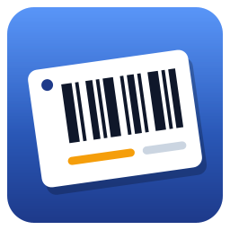
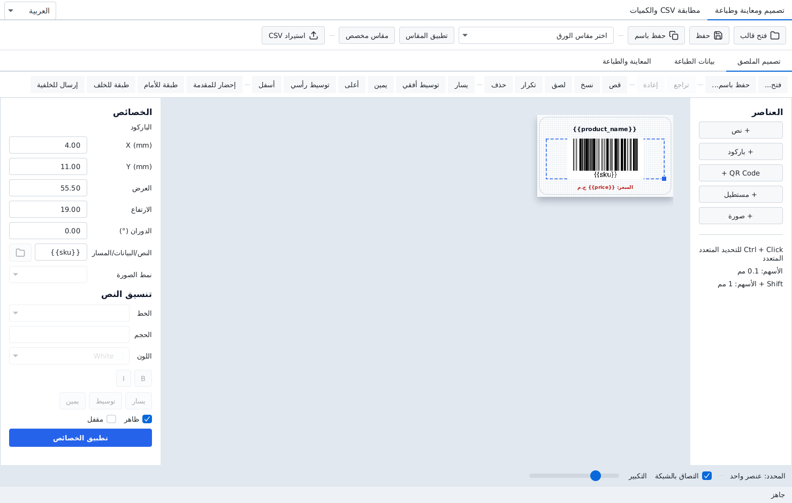
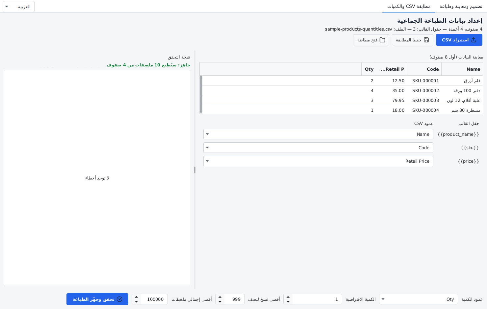
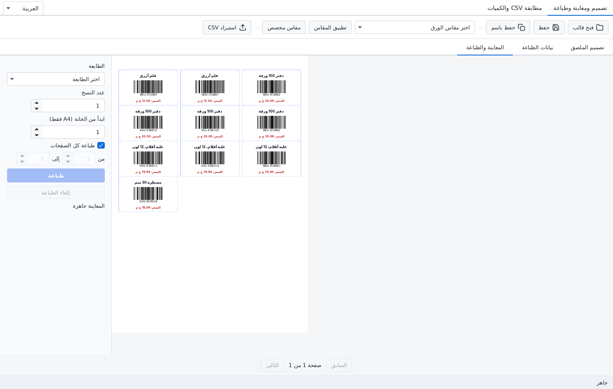

#  Barcode Label Suite

[](https://github.com/MohamedSalah-13/barcode-label-suite/actions/workflows/build.yml)    [](LICENSE)

[English](README.md) | **العربية**

برنامج ومكتبة Java 21 / JavaFX لتصميم ملصقات الباركود وطباعتها، بواجهة عربية وإنجليزية. تصمم الملصق مرة واحدة، ثم تطبع منه دفعة كاملة من ملف CSV، بعدد النسخ الذي تحدده لكل صنف.

## صور من البرنامج

تصميم الملصق: العناصر على اليمين، والملصق على سطحه بالمليمتر، وخصائص العنصر المحدد على اليسار. قائمة اللغة في طرف شريط التبويبات.



استيراد ملف CSV: يربط البرنامج الأعمدة بحقول القالب وبعمود الكمية تلقائيًا، ثم يتحقق منها (10 ملصقات من 4 صفوف).



معاينة طباعة هذه الدفعة على ورقة A4، ملصق لكل نسخة.



## ماذا يقدّم الإصدار الحالي

الإصدار الحالي `0.7.0`، وفيه:

- نموذج قوالب ملصقات ثابت (immutable) بالمليمتر.
- ورق ملصقات (Sheet)، ورول، وملصق واحد في الصفحة.
- عناصر نص وباركود و QR وصورة وأشكال.
- حفظ القوالب وفتحها بصيغة JSON مع رقم إصدار للصيغة.
- ربط الحقول بالبيانات بصيغة `{{field}}`.
- مصمم ملصقات JavaFX قابل لإعادة الاستخدام، ومعاينة عالية الجودة.
- واجهة عربية (من اليمين لليسار) وإنجليزية (من اليسار لليمين)، تختارها من قائمة ويتذكرها البرنامج.
- رسم الباركود وطباعته بـ Java2D على ورق الملصقات والرول والملصق الواحد.
- استيراد CSV، واقتراح ربط الأعمدة تلقائيًا من أسمائها بالعربية والإنجليزية، وتكرار كل صف حسب الكمية، والتحقق من الدفعة.
- طباعة نطاق من الصفحات، وإلغاء الطباعة، ورسائل واضحة عند فشلها.
- شاشة إنتاج جماعي متكاملة.

ما تغيّر في كل إصدار موجود في [`CHANGELOG.md`](CHANGELOG.md).

## التحميل

في كل إصدار على [صفحة الإصدارات](https://github.com/MohamedSalah-13/barcode-label-suite/releases) مثبّت Windows باسم `BarcodeLabelSuite-<version>-setup.exe` ونسخة محمولة باسم `BarcodeLabelSuite-<version>-windows.zip`، وكلاهما يحمل Java الخاصة به فلا تحتاج إلى تثبيت Java. المثبّت يثبّت البرنامج للمستخدم الحالي دون صلاحيات مدير، والنسخة المثبّتة تحدّث نفسها: تبحث عن إصدار جديد بعد التشغيل بقليل ثم كل ست ساعات، وزر **التحقق من التحديثات** بجانب قائمة اللغة يبحث فورًا. عند التحديث يُنزَّل المثبّت ويُتحقق من SHA-256 الخاص به ثم يُثبَّت ويُفتح البرنامج من جديد. أما النسخة المحمولة ففك ضغطها وشغّل `BarcodeLabelSuite\BarcodeLabelSuite.exe`.

## المتطلبات

- JDK 21، ويجب أن يشير `JAVA_HOME` إليه.
- Windows لملف التشغيل المرفق والتغليف والطباعة من سطح المكتب. المكتبة واختباراتها تُبنى أيضًا على Linux و macOS.

المستودع يحتوي على Maven Wrapper 3.9.9، فلا تحتاج إلى تثبيت Maven منفصل.

## البناء والتشغيل

كل الموديولات تُبنى معًا من ملف `pom.xml` الرئيسي، بالترتيب الصحيح وبإصدار واحد.

بناء المشروع واختباره ثم تشغيل البرنامج:

```powershell
.\start.cmd
```

```bash
./start.sh
```

البناء والاختبار بدون تشغيل البرنامج:

```powershell
.\mvnw.cmd clean install
```

```bash
./mvnw clean install
```

اختبارات واجهة JavaFX تحتاج إلى شاشة، فعلى Linux بدون شاشة شغّل البناء عبر `xvfb-run`:

```bash
xvfb-run -a ./mvnw clean install
```

بعد البناء يمكنك تشغيل البرنامج وحده بالأمر `./mvnw -pl barcode-label-app javafx:run`.

### جرّب البرنامج بملف العينة

يفتح البرنامج بالعربية أول مرة. للتبديل إلى الإنجليزية اختر **English** من قائمة اللغة في طرف شريط التبويبات (أعلى يسار النافذة بالعربية)؛ تُفتح النافذة من جديد بالإنجليزية ويتذكر البرنامج اختيارك. الملصق الذي تصممه يبقى كما هو، أما ملف CSV فتحتاج إلى استيراده مرة أخرى.

يفتح البرنامج على ملصق منتجات في ورقة A4 من 3 × 7 ملصقات (63.5 × 38.1 مم)، وحقوله `{{product_name}}` و`{{sku}}` و`{{price}}`. ملف [`sample-products-quantities.csv`](sample-products-quantities.csv) فيه أربعة أصناف وعدد الملصقات المطلوب لكل صنف ([`sample-products-quantities-en.csv`](sample-products-quantities-en.csv) هو نفس البيانات بالإنجليزية):

```csv
Name,Code,Retail Price,Qty
قلم أزرق,SKU-000001,12.50,2
دفتر 100 ورقة,SKU-000002,35.00,4
"علبة أقلام، 12 لون",SKU-000003,79.95,3
مسطرة 30 سم,SKU-000004,18.00,1
```

1. افتح تبويب **مطابقة CSV والكميات**.
2. اضغط **استيراد CSV** واختر `sample-products-quantities.csv`.
3. يربط البرنامج الأعمدة بالحقول من أسمائها: `Name` مع `product_name`، و`Code` مع `sku`، و`Retail Price` مع `price`، و`Qty` في **عمود الكمية**. راجع الاقتراح وغيّر أي ربط غير صحيح.
4. اضغط **تحقق وجهّز الطباعة**. تظهر رسالة **جاهز: سيُطبع 10 ملصقات من 4 صفوف** (2 + 4 + 3 + 1).
5. ارجع إلى **تصميم ومعاينة وطباعة** وافتح **المعاينة والطباعة**. تملأ الملصقات العشرة الورقة الأولى بالترتيب.
6. اختر الطابعة وعدد النسخ، وإذا كان جزء من الورقة مستخدمًا فاختر الخانة التي تبدأ منها، ثم اضغط **طباعة**.

الربط التلقائي يعرف أيضًا المرادفات الشائعة بالعربية والإنجليزية (`الصنف`، `الكود`، `Barcode`، `السعر`، `الكمية`، `عدد النسخ`…)، فلا يلزم أن تستخدم ملفاتك هذه الأسماء بالضبط. لحفظ المطابقة وإعادة استخدامها استخدم **حفظ المطابقة** و**فتح مطابقة**. الدليل الكامل في [`docs/USER_GUIDE_AR.md`](docs/USER_GUIDE_AR.md).

كل موديول فيه اختبارات يشترط تغطية 70% على الأقل من الأسطر عبر JaCoCo. اختبارات الواجهة تشغّل JavaFX فعلًا، وتجهّز دفعة مربوطة، وتنقلها إلى شاشة الطباعة، وتعرض معاينة من عدة صفحات وتتنقل بينها، بالعربية والإنجليزية. تقارير التغطية في مجلد `target/site/jacoco` داخل كل موديول.

## التغليف لـ Windows

لإنشاء نسخة مستقلة من البرنامج (معها Java الخاصة بها) باستخدام `jpackage` من JDK 21:

```powershell
.\package.ps1
```

تجد البرنامج الجاهز في `dist\BarcodeLabelSuite`. يمكن أيضًا إنشاء ملف تثبيت بالخيار `-Type exe` أو `-Type msi`، وهذا يحتاج إلى WiX Toolset على Windows. استخدم `-SkipBuild` فقط بعد نجاح `mvnw clean install` في نفس النسخة من الكود. يحتاج السكربت نسخة من [desktop-updater](https://github.com/MohamedSalah-13/desktop-updater) بجوار هذا المستودع (أو المسار في `DESKTOP_UPDATER_HOME`): خطوات التغليف المشتركة بين البرامج في `tools/Packaging.psm1` هناك.

لإضافة شاشات البرنامج إلى برنامج JavaFX آخر راجع [`docs/INTEGRATION_AR.md`](docs/INTEGRATION_AR.md).

## نشر إصدار جديد

1. غيّر رقم الإصدار في `pom.xml` الرئيسي (كل الموديولات تأخذه منه)، وأضف قسمًا له في `CHANGELOG.md`.
2. ادمج ذلك في `master`.
3. أنشئ وسمًا `v<version>` على commit الدمج وارفعه.

بعدها يتأكد [workflow الإصدار](.github/workflows/release.yml) أن الوسم يطابق الإصدار في `pom.xml` وأن `CHANGELOG.md` فيه ملاحظات له، ثم يبني كل الموديولات ويختبرها، ويغلّف برنامج Windows، وينشره كإصدار على GitHub بتلك الملاحظات.

## الموديولات الرئيسية

- `barcode-label-model`: نموذج الملصق، مستقل عن الواجهة.
- `barcode-label-data`: حفظ JSON وربط الحقول.
- `barcode-label-render`: واجهات (contracts) الرسم.
- `barcode-label-print`: تخطيط الورق وواجهات الطباعة.
- `barcode-label-render-java2d`: الرسم بـ ZXing و Barcode4J.
- `barcode-label-print-java2d`: الطباعة بـ Java2D.
- `barcode-label-workflow`: استيراد CSV وتخطيط الصفحات.
- `barcode-label-batch`: المطابقة والتحقق وتجهيز الدفعة.
- `barcode-label-fx-designer` و`barcode-label-fx-workbench` و`barcode-label-fx-batch`: طبقات واجهة JavaFX قابلة لإعادة الاستخدام. كل منها يأخذ `UiLanguage` (`ARABIC` أو `ENGLISH`)، ونصوصه في `messages_ar.properties` و`messages_en.properties` بجانب كلاساته.
- `barcode-label-app`: برنامج سطح المكتب للإنتاج الجماعي.

## الترخيص

المشروع منشور برخصة [MIT](LICENSE).
