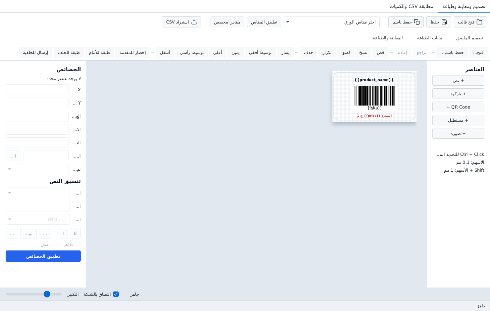

# Barcode Label Suite

[](https://github.com/MohamedSalah-13/barcode-label-suite/actions/workflows/build.yml)    [](LICENSE)

A reusable, modular Java 21 / JavaFX library for designing and printing barcode labels.

## Screenshots

Designing a label: the elements on the right, the label on its own millimetre surface, the properties on the left.



Importing a CSV: the columns are matched to the template's fields and the quantity column automatically, then validated (10 labels from 4 rows).


The print preview of that batch on an A4 sheet, one label per copy.


## Current release

The current version is `0.7.0`. It provides:

- An immutable label-template model using millimetres.
- Sheet, single-label and roll page definitions.
- Text, barcode, image and shape elements.
- JSON save/load with a schema version.
- `{{field}}` data binding.
- A reusable JavaFX label designer and high-quality preview.
- Java2D barcode rendering and printing for sheets, rolls and single labels.
- CSV import, automatic column suggestions (English and Arabic names), quantity expansion and batch validation.
- Page-range printing, cancellation and typed print failures.
- A batch-production desktop workbench.

See [`CHANGELOG.md`](CHANGELOG.md) for what changed in each version.

## Download

Each release on the [Releases page](https://github.com/MohamedSalah-13/barcode-label-suite/releases) has a Windows build, `BarcodeLabelSuite-<version>-windows.zip`. Unzip it and run `BarcodeLabelSuite\BarcodeLabelSuite.exe`; it includes its own Java runtime.

## Requirements

- JDK 21 (`JAVA_HOME` must point to it).
- Windows for the supplied launch script, packaging and desktop printing workflow. The library and its tests also build on Linux and macOS.

The repository includes Maven Wrapper 3.9.9, so a separate Maven installation is optional.

## Build and run

All modules build in a single Maven reactor from the root `pom.xml`, in dependency order, with one shared version.

Build, test and start the application:

```powershell
.\start.cmd
```

```bash
./start.sh
```

Build and test without starting the application:

```powershell
.\mvnw.cmd clean install
```

```bash
./mvnw clean install
```

The JavaFX UI tests need a display, so on a headless Linux machine run the build under `xvfb-run`:

```bash
xvfb-run -a ./mvnw clean install
```

After an install, the application alone starts with `./mvnw -pl barcode-label-app javafx:run`.

### Try it with the sample CSV

The application opens with a product label on an A4 sheet of 3 × 7 labels (63.5 × 38.1 mm). Its fields are `{{product_name}}`, `{{sku}}` and `{{price}}`. [`sample-products-quantities.csv`](sample-products-quantities.csv) has four products and how many labels each needs:

```csv
Name,Code,Retail Price,Qty
قلم أزرق,SKU-000001,12.50,2
دفتر 100 ورقة,SKU-000002,35.00,4
"علبة أقلام، 12 لون",SKU-000003,79.95,3
مسطرة 30 سم,SKU-000004,18.00,1
```

1. Open the **مطابقة CSV والكميات** tab (CSV mapping and quantities).
2. Click **استيراد CSV** (Import CSV) and choose `sample-products-quantities.csv`.
3. The columns are matched to the fields from their names: `Name` → `product_name`, `Code` → `sku`, `Retail Price` → `price`, and `Qty` becomes the quantity column (**عمود الكمية**). Check the suggestion and change any wrong match.
4. Click **تحقق وجهّز الطباعة** (Validate and prepare printing). The summary reads **جاهز: سيُطبع 10 ملصقات من 4 صفوف**: ready, 10 labels from 4 rows (2 + 4 + 3 + 1).
5. Go back to **تصميم ومعاينة وطباعة** (Design, preview and print) and open **المعاينة والطباعة** (Preview and print). The 10 labels fill the first sheet in order.
6. Choose a printer, the copies and, if part of the sheet is already used, the slot to start from, then click **طباعة** (Print).

The matching also knows common Arabic and English synonyms (`الصنف`, `الكود`/`Barcode`, `السعر`, `الكمية`, `عدد النسخ`…). Your own CSV files therefore need not use these exact names. To save a mapping and reuse it, use **حفظ المطابقة** (Save mapping) and **فتح مطابقة** (Open mapping). The full guide, in Arabic, is [`docs/USER_GUIDE_AR.md`](docs/USER_GUIDE_AR.md).

Every tested module enforces a minimum 70% line-coverage baseline with JaCoCo. The UI integration tests start the JavaFX toolkit, prepare a mapped batch, propagate it into the print workspace, render a multi-page preview and exercise page navigation. HTML reports are written to each tested module's `target/site/jacoco` directory.

## Package for Windows

Create a self-contained application image (including a private Java runtime) with JDK 21 `jpackage`:

```powershell
.\package.ps1
```

The runnable application is created under `dist\BarcodeLabelSuite`. Installer formats are also supported with `-Type exe` or `-Type msi`; those formats require WiX Toolset on Windows. Use `-SkipBuild` only after a successful `mvnw clean install` in the current checkout.

An Arabic user guide is in [`docs/USER_GUIDE_AR.md`](docs/USER_GUIDE_AR.md), and Arabic instructions for embedding the modules in another JavaFX app are in [`docs/INTEGRATION_AR.md`](docs/INTEGRATION_AR.md).

## Releasing

1. Set the version in the root `pom.xml` (every module inherits it) and add a section for it to `CHANGELOG.md`.
2. Merge that to `master`.
3. Tag the merge commit `v<version>` and push the tag.

The [release workflow](.github/workflows/release.yml) then checks the tag matches `pom.xml` and that `CHANGELOG.md` has notes for it, builds and tests every module, packages the Windows application and publishes it as a GitHub release with those notes.

## Main modules

- `barcode-label-model`: UI-independent document model.
- `barcode-label-data`: JSON persistence and field binding.
- `barcode-label-render`: renderer contracts.
- `barcode-label-print`: sheet planning and print contracts.
- `barcode-label-render-java2d`: ZXing/Barcode4J rendering implementation.
- `barcode-label-print-java2d`: shared Java2D printing implementation.
- `barcode-label-workflow`: CSV import and universal page planning.
- `barcode-label-batch`: mapping, validation and batch preparation.
- `barcode-label-fx-designer`, `barcode-label-fx-workbench`, `barcode-label-fx-batch`: reusable JavaFX UI layers.
- `barcode-label-app`: the batch-production desktop application.

## License

Released under the [MIT License](LICENSE).
