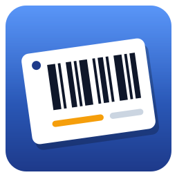
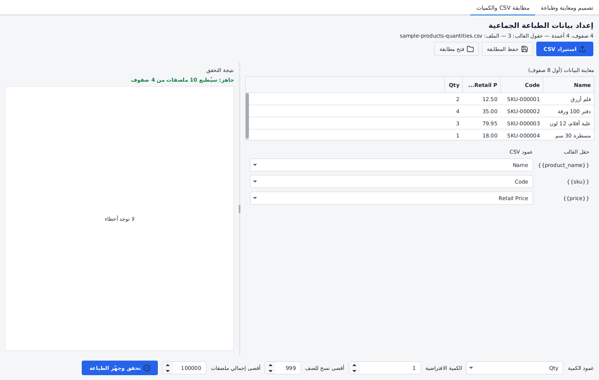
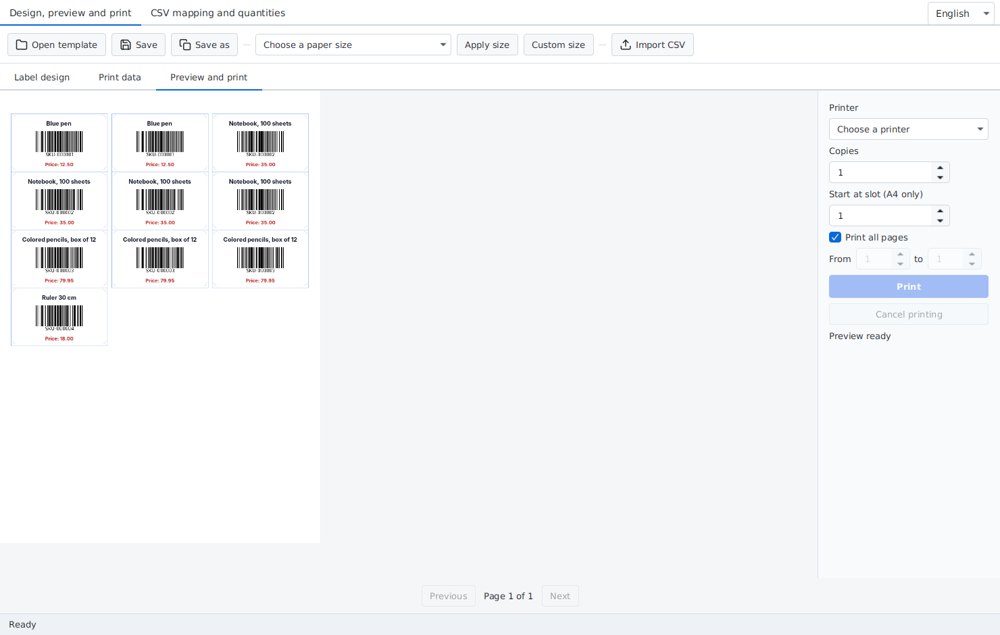

#  Barcode Label Suite

[](https://github.com/MohamedSalah-13/barcode-label-suite/actions/workflows/build.yml)    [](LICENSE)

**English** | [العربية](README.ar.md)

A reusable, modular Java 21 / JavaFX library for designing and printing barcode labels, with an Arabic and English interface.

## Screenshots

Designing a label: the elements on the left, the label on its own millimetre surface, the selected element's properties on the right. The language menu is at the end of the tab bar.


Importing a CSV: the columns are matched to the template's fields and the quantity column automatically, then validated (10 labels from 4 rows).



The print preview of that batch on an A4 sheet, one label per copy.



## Current release

The current version is `0.8.0`. It provides:

- An immutable label-template model using millimetres.
- Sheet, single-label and roll page definitions.
- Text, barcode, image and shape elements.
- JSON save/load with a schema version.
- `{{field}}` data binding.
- A reusable JavaFX label designer and high-quality preview.
- An Arabic (right-to-left) and English (left-to-right) interface, chosen from a menu and remembered between runs.
- Java2D barcode rendering and printing for sheets, rolls and single labels.
- CSV import, automatic column suggestions (English and Arabic names), quantity expansion and batch validation.
- Page-range printing, cancellation and typed print failures.
- A batch-production desktop workbench.

See [`CHANGELOG.md`](CHANGELOG.md) for what changed in each version.

## Download

Each release on the [Releases page](https://github.com/MohamedSalah-13/barcode-label-suite/releases) has a Windows installer, `BarcodeLabelSuite-<version>-setup.exe`, and a portable build, `BarcodeLabelSuite-<version>-windows.zip`. Both include their own Java runtime. The installer installs for the current user without asking for an administrator, and an installed copy updates itself: it looks for a new release shortly after it starts and every six hours, and **Check for updates** beside the language menu looks at once. Updating downloads the installer, checks its SHA-256, installs it and opens the app again. To use the zip, unzip it and run `BarcodeLabelSuite\BarcodeLabelSuite.exe`.

## Requirements

- JDK 21 (`JAVA_HOME` must point to it).
- Windows for the supplied launch script, packaging and desktop printing workflow. The library and its tests also build on Linux and macOS.

The repository includes Maven Wrapper 3.9.9, so a separate Maven installation is optional.

## Build and run

All modules build in a single Maven reactor from the root `pom.xml`, in dependency order, with one shared version.

Build, test and start the application:

```powershell
.\start.cmd
```

```bash
./start.sh
```

Build and test without starting the application:

```powershell
.\mvnw.cmd clean install
```

```bash
./mvnw clean install
```

The JavaFX UI tests need a display, so on a headless Linux machine run the build under `xvfb-run`:

```bash
xvfb-run -a ./mvnw clean install
```

After an install, the application alone starts with `./mvnw -pl barcode-label-app javafx:run`.

### Try it with the sample CSV

The application opens in Arabic the first time. To switch to English, choose **English** in the language menu at the end of the tab bar (top left in Arabic); the window reopens in English, and the choice is remembered. The label you are designing is kept, but an imported CSV file has to be imported again.

The application opens with a product label on an A4 sheet of 3 × 7 labels (63.5 × 38.1 mm). Its fields are `{{product_name}}`, `{{sku}}` and `{{price}}`. [`sample-products-quantities-en.csv`](sample-products-quantities-en.csv) has four products and how many labels each needs ([`sample-products-quantities.csv`](sample-products-quantities.csv) is the same data in Arabic):

```csv
Name,Code,Retail Price,Qty
Blue pen,SKU-000001,12.50,2
"Notebook, 100 sheets",SKU-000002,35.00,4
"Colored pencils, box of 12",SKU-000003,79.95,3
Ruler 30 cm,SKU-000004,18.00,1
```

1. Open the **CSV mapping and quantities** tab.
2. Click **Import CSV** and choose `sample-products-quantities-en.csv`.
3. The columns are matched to the fields from their names: `Name` → `product_name`, `Code` → `sku`, `Retail Price` → `price`, and `Qty` becomes the **Quantity column**. Check the suggestion and change any wrong match.
4. Click **Validate and prepare printing**. The summary reads **Ready: 10 labels will print from 4 rows** (2 + 4 + 3 + 1).
5. Go back to **Design, preview and print** and open **Preview and print**. The 10 labels fill the first sheet in order.
6. Choose a printer, the copies and, if part of the sheet is already used, the slot to start from, then click **Print**.

The matching also knows common English and Arabic synonyms (`Product`, `Barcode`, `Price`, `Quantity`, `الصنف`, `الكود`, `السعر`, `الكمية`…). Your own CSV files therefore need not use these exact names. To save a mapping and reuse it, use **Save mapping** and **Open mapping**. The full user guide, in Arabic, is [`docs/USER_GUIDE_AR.md`](docs/USER_GUIDE_AR.md).

Every tested module enforces a minimum 70% line-coverage baseline with JaCoCo. The UI integration tests start the JavaFX toolkit, prepare a mapped batch, propagate it into the print workspace, render a multi-page preview and exercise page navigation. HTML reports are written to each tested module's `target/site/jacoco` directory.

## Package for Windows

Create a self-contained application image (including a private Java runtime) with JDK 21 `jpackage`:

```powershell
.\package.ps1
```

The runnable application is created under `dist\BarcodeLabelSuite`. Installer formats are also supported with `-Type exe` or `-Type msi`; those formats require WiX Toolset on Windows. Use `-SkipBuild` only after a successful `mvnw clean install` in the current checkout.

An Arabic user guide is in [`docs/USER_GUIDE_AR.md`](docs/USER_GUIDE_AR.md), and Arabic instructions for embedding the modules in another JavaFX app are in [`docs/INTEGRATION_AR.md`](docs/INTEGRATION_AR.md).

## Releasing

1. Set the version in the root `pom.xml` (every module inherits it) and add a section for it to `CHANGELOG.md`.
2. Merge that to `master`.
3. Tag the merge commit `v<version>` and push the tag.

The [release workflow](.github/workflows/release.yml) then checks the tag matches `pom.xml` and that `CHANGELOG.md` has notes for it, builds and tests every module, packages the Windows application and publishes it as a GitHub release with those notes.

## Main modules

- `barcode-label-model`: UI-independent document model.
- `barcode-label-data`: JSON persistence and field binding.
- `barcode-label-render`: renderer contracts.
- `barcode-label-print`: sheet planning and print contracts.
- `barcode-label-render-java2d`: ZXing/Barcode4J rendering implementation.
- `barcode-label-print-java2d`: shared Java2D printing implementation.
- `barcode-label-workflow`: CSV import and universal page planning.
- `barcode-label-batch`: mapping, validation and batch preparation.
- `barcode-label-fx-designer`, `barcode-label-fx-workbench`, `barcode-label-fx-batch`: reusable JavaFX UI layers. Each takes a `UiLanguage` (`ARABIC` or `ENGLISH`); its texts are in `messages_ar.properties` and `messages_en.properties` next to its classes.
- `barcode-label-app`: the batch-production desktop application.

## License

Released under the [MIT License](LICENSE).
