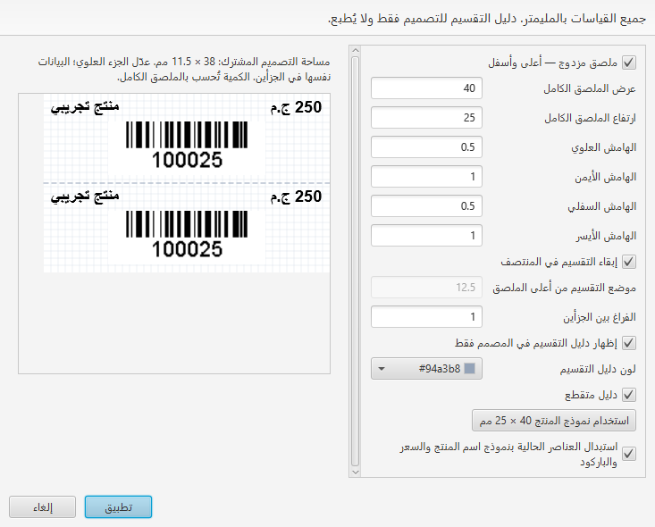

# تشغيل البرنامج

الإصدار الحالي هو `0.8.0`. كل الموديولات تُبنى من ملف `pom.xml` الرئيسي بأمر واحد.

لبناء المشروع وتشغيل الاختبارات ثم فتح البرنامج:

```powershell
cd <مسار المشروع>\barcode-label-suite
.\start.cmd
```

على Linux أو macOS استخدم `./start.sh`.

للبناء والاختبار فقط بدون فتح الواجهة:

```powershell
.\mvnw.cmd clean install
```

بعد نجاح البناء، أنشئ تطبيق Windows مستقلًا يحتوي على Java runtime خاص به:

```powershell
.\package.ps1 -SkipBuild
```

ستجد الملف التنفيذي في `dist\BarcodeLabelSuite\BarcodeLabelSuite.exe`. لا تستخدم
`-SkipBuild` إلا بعد نجاح `mvnw.cmd clean install` على النسخة الحالية من الكود.

## تجربة سريعة

### ملصق مزدوج بنفس البيانات — 40 × 25 مم



1. افتح **إعدادات الملصق** من لوحة المصمم، أو زر الإعدادات بجوار مقاس الورق.
2. اضغط **استخدام نموذج المنتج 40 × 25 مم**. يحدد الخيار الظاهر أسفله استبدال العناصر الحالية باسم منتج وسعر وباركود ورقمه؛ لن يتغير القالب قبل الضغط على **تطبيق**.
3. راجع عرض الملصق الكامل وارتفاعه والهوامش والفراغ بين الجزأين. التقسيم في المنتصف افتراضيًا، ويمكن إلغاء **إبقاء التقسيم في المنتصف** لتحديد موضعه من أعلى الملصق.
4. دليل التقسيم يظهر في المصمم فقط. يمكن إخفاؤه أو تغيير لونه ونمطه؛ لا يظهر في ناتج الطباعة أو صورة الملصق.
5. اضغط **تطبيق**، ثم عدّل عناصر الجزء العلوي. يتكرر المحتوى والتنسيق في الجزء السفلي تلقائيًا. رقم الباركود جزء من عنصر الباركود نفسه، فيتغير مع قيمته.
6. افتح تبويب الطباعة لمراجعة الناتج. الكمية 10 تعني عشرة ملصقات كاملة، في كل منها نسختان من البيانات نفسها.

المقاس 40 × 25 مم هو مقاس الملصق الكامل. لا تصغّر الإعدادات العناصر تلقائيًا؛ إذا لم تتسع العناصر في الجزأين يُمنع تطبيق إعدادات مزدوجة غير ملائمة، وتُمنع الطباعة إذا أصبحت العناصر خارج المساحة لاحقًا. عند نقل التقسيم بعيدًا عن المنتصف، تُستخدم مساحة محتوى مشتركة تناسب الجزء الأصغر، مع الحفاظ على أحجام النص والباركود.

النموذج يحافظ على نوع الورق الحالي: في ورقة A4 يغيّر مقاس كل ملصق مع بقاء الصفوف والأعمدة، وفي الرول يغيّر مقاس الملصق الكامل. لاختيار الرول استخدم إعدادات الورق الموجودة، أو افتح المثال الجاهز [sample-dual-label-40x25.label.json](../sample-dual-label-40x25.label.json).

يمكن التراجع عن تطبيق الإعدادات، وتُحفظ مع القالب. يظل فتح القوالب القديمة مدعومًا؛ القالب المزدوج يستخدم إصدار التنسيق 2 ويتطلب هذه النسخة من البرنامج أو نسخة أحدث.

### تجربة CSV والكميات

1. افتح تبويب **مطابقة CSV والكميات**.
2. استورد `sample-products-quantities.csv`.
3. يقترح البرنامج ربط الأعمدة من أسمائها: `product_name` مع `Name`، و`sku` مع `Code`، و`price` مع `Retail Price`، و`Qty` في **عمود الكمية**. راجع الاقتراح وغيّر أي ربط غير صحيح.
4. اضغط **تحقق وجهّز الطباعة**.
5. إذا ظهرت كلمة **جاهز**، ارجع إلى **تصميم ومعاينة وطباعة** ثم افتح المعاينة.

إذا ظهر خطأ يحمل رقم صف CSV، اضغط عليه في قائمة الفحص لعرض ملصق ذلك الصف تحت القائمة. تظهر علامة حمراء في موضع الباركود إذا تعذّر رسمه. يمكنك الانتقال بين الأخطاء بمفاتيح الأسهم أيضًا. صحّح البيانات أو ربط الأعمدة ثم اضغط «تحقق وجهّز الطباعة» مجددًا لرفع حظر الطباعة بعد نجاح الفحص.

الاقتراح التلقائي يتعرف على الأسماء المتطابقة، وعلى المرادفات الشائعة بالعربية والإنجليزية: مثلًا `الصنف` أو `اسم المنتج` للاسم، و`الكود` أو `Barcode` للكود، و`السعر` أو `سعر البيع` للسعر، و`الكمية` أو `عدد النسخ` للكمية.

## معايرة الطباعة

اختر مقاس الورق، ثم افتح **المعاينة والطباعة** واختر الطابعة واضغط **معايرة الطباعة**.

1. اضغط **طباعة ورقة اختبار**. تخرج ورقة واحدة عليها علامة + بإزاحة صفر، حتى لو سبق حفظ معايرة.
2. قِس بالمليمتر من الحافة اليسرى إلى مركز العلامة، ثم من الحافة العليا إلى المركز. تعرض نافذة المعايرة المسافتين المطلوبتين لهذا المقاس.
3. لكل محور، اطرح القياس الفعلي من المسافة المطلوبة. مثلًا، إذا كان المطلوب 10 مم في الاتجاهين وقست 12 مم من اليسار و9 مم من الأعلى، فأدخل **−2** أفقيًا و**+1** رأسيًا.
4. اضغط **حفظ المعايرة**. يسترجع البرنامج الإزاحتين عند الطباعة بنفس الطابعة وأبعاد الورق، حتى بعد إعادة تشغيله. لإلغاء التصحيح لهذا المقاس، احفظ صفرًا في الحقلين.

## لغة الواجهة

البرنامج بالعربية أو الإنجليزية. يفتح بالعربية أول مرة، ولتغيير اللغة اختر **English** أو **العربية** من قائمة اللغة في طرف شريط التبويبات (أعلى يسار النافذة بالعربية، وأعلى يمينها بالإنجليزية). تُفتح النافذة من جديد باللغة المختارة، ويتذكرها البرنامج في المرات القادمة.

عند تغيير اللغة يبقى الملصق الذي تصممه وملف CSV المحمّل وربط الأعمدة وعمود الكمية وحدود النسخ ونتيجة التحقق محفوظين. يبقى أيضًا التبويب والصفحة الحالية وإعدادات الطباعة، سواء استوردت البيانات في مساحة الطباعة مباشرة أو جهّزتها من تبويب الربط. تُعرض رسائل التحقق باللغة الجديدة وتظل طباعة الدفعة غير الصالحة محظورة، ولا تحتاج إلى إعادة الاستيراد أو التحضير. يتوقف اختيار اللغة مؤقتًا أثناء قراءة الملفات أو تحضير الدفعة أو إرسال الطباعة حتى تكتمل العملية. هذا الاحتفاظ بالجلسة يخص تبديل اللغة أثناء تشغيل التطبيق؛ لا يحفظ CSV بين مرات التشغيل. إذا لم تعدّل الملصق الافتتاحي بعد، تتغير نصوصه مع اللغة أيضًا (مثل «السعر:» و«Price:»).

سطح الملصق في المصمم من اليسار لليمين باللغتين، لأنه يطابق الملصق المطبوع.

لإضافة الواجهة إلى مشروع آخر استخدم artifact التالي:

```xml
<dependency>
    <groupId>com.mohamed.barcodelabel</groupId>
    <artifactId>barcode-label-fx-batch</artifactId>
    <version>0.8.0</version>
</dependency>
```
